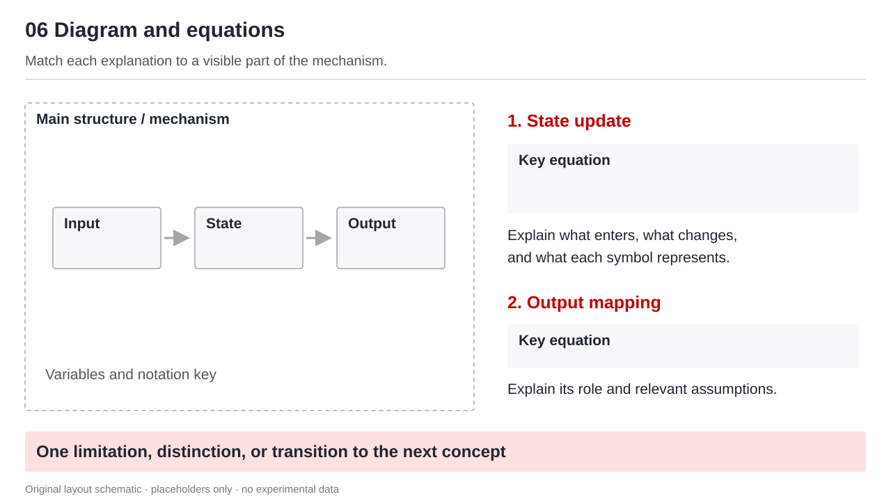

# Skills for Research Presentations

Help an AI agent explain research through diagrams, concise explanations, and evidence-supported conclusions.

Small, editable agent skills for paper presentations, lab meetings, and system design reviews. The first skill focuses on slide body layouts while preserving your chosen template. Instructions are written primarily in Chinese; the skill can produce content in the language you request.

[中文](README.md) · [Layout recipes](skills/scu-ppt-body-style/references/layouts.md)

## Installation

With Node.js and Git installed:

```bash
npx skills@latest add tsx-lqy/skill --skill scu-ppt-body-style
```

Choose your agent when prompted. Installation is project-local by default. For a global Codex installation using regular file copies:

```bash
npx skills@latest add tsx-lqy/skill --skill scu-ppt-body-style -a codex -g --copy
```

For Claude Code, replace `-a codex` with `-a claude-code`. Start a new agent session after installing, or refresh its skill list as directed by that agent. See the [Skills CLI documentation](https://github.com/vercel-labs/skills) for other agents.

Alternatively, [download the ZIP](https://github.com/tsx-lqy/skill/archive/refs/heads/main.zip) and copy the entire `skills/scu-ppt-body-style` folder to your agent's skills directory. Keep the references and images together with `SKILL.md`. Preserve any local customizations before replacing an existing installation.

To update installed skills:

```bash
npx skills@latest update
```

Save local customizations before updating.

## Usage

```text
Use $scu-ppt-body-style to turn this paper into an eight-slide research presentation.
Write in English, preserve my blue template, and focus on methods, comparisons, and limitations.
```

Supply the research material, figures, and any template you want preserved. The skill guides organization and design. Your agent still needs tools to create, edit, and render presentation files; installing this skill alone does not install PowerPoint or produce a deck.

## Skills

| Skill | Purpose |
|---|---|
| [scu-ppt-body-style](skills/scu-ppt-body-style/SKILL.md) | Research slide body design: typography and color, three narrative structures, eight layout recipes, original SVG diagrams, and delivery checks |

The eight recipes cover system overviews, diagrams with equations, progressive system explanations, results with metrics, comparison matrices, paired evidence, feedback loops, and parallel mechanisms.



## Provenance

The design guidance was distilled from three research presentations. This public edition includes independently written guidance and original schematic diagrams. It does not redistribute source decks, research screenshots, experimental images, institutional logos, or machine-specific paths. The `scu` identifier does not imply university endorsement.

Repository presentation and installation-first navigation were inspired by [mattpocock/skills](https://github.com/mattpocock/skills). The research presentation guidance is independently developed.

## Contributing

Open an issue with your agent, input type, expected result, and observed result. Only submit material that is appropriate to publish.

Run the package checks after changes:

```bash
python scripts/validate_skills.py
```

These checks cover structure, metadata, relative links, SVG validity, and the public package file set. They do not replace visual inspection of generated presentations.

## License

[MIT](LICENSE), covering the guidance, documentation, validation script, and original SVG diagrams distributed here. It grants no rights to source decks, research figures, fonts, or trademarks that are not distributed in this repository.
