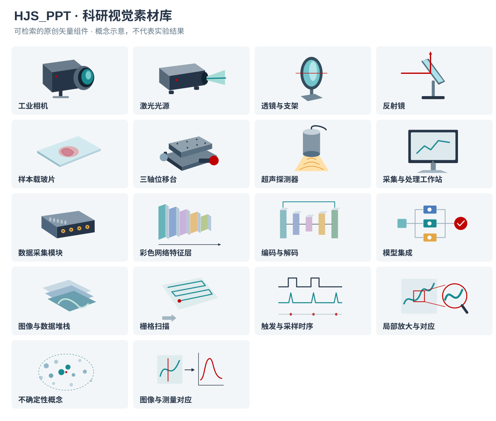
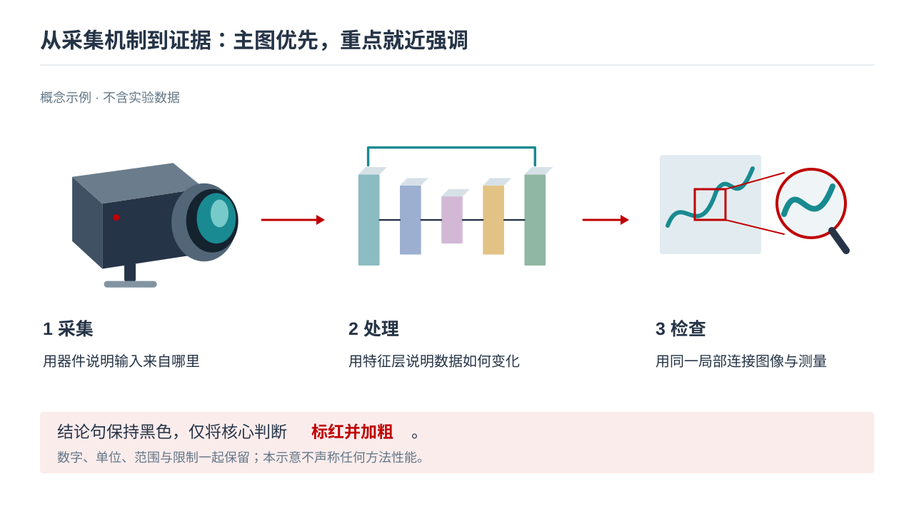

# 科研视觉素材库

制作正文时先读本页并浏览 [素材总览](../assets/gallery.svg)，按本页要解释的对象选素材。既有的 15 张版式示意是布局配方，**不是可反复填满整份 PPT 的线框素材**。

## 从参考稿学到什么

会议稿的系统页把立体器件、不同颜色的物理路径、彩色网络层与输入输出放在一起；实验页把真实装置照片与局部标注对应；结果页把同一 ROI 的整图、放大图和曲线对应。文献组会也使用多层图像、透镜/探测区域和网络结构。复试稿以相邻页面说明“机制示意 → 实物实现”，并在步骤旁放器件和原理图。

迁移这些**表征方式和对应关系**，而不是沿用原研究图像、装置身份或结论。避免把具体相机、镜片、组织、图像栈全部替换成同样的矩形。

## 公开包中的素材



| 类别 | 素材 ID | 适合的用途 |
|---|---|---|
| 器件与实验 | `camera`、`laser`、`lens`、`mirror`、`sample-slide`、`translation-stage`、`transducer`、`computer`、`daq` | 解释物理对象、采集链和功能；不暗示具体型号或系统已经搭建 |
| 模型与数据 | `neural-layers`、`encoder-decoder`、`ensemble`、`image-stack` | 展示特征层、编码解码、多模型预测、多帧数据；真实尺寸与运算另行标注 |
| 过程与证据 | `scan-pattern`、`timing-pulses`、`roi-magnifier`、`uncertainty-cloud`、`evidence-link` | 表示扫描、触发、放大关系和概念散布；示意曲线不得当成数据 |
| AI 概念配图 | `optical-bench-concept` | 背景/原理页的大图；必须标为概念示意，不能用作实物照片 |

目录位于 [catalog.json](../assets/catalog.json)，每项包含标签、用途、类型与文件路径。可按中文或英文检索：

```bash
python "<skill-dir>/scripts/find_asset.py" "相机"
python "<skill-dir>/scripts/find_asset.py" "network"
python "<skill-dir>/scripts/find_asset.py" "局部"
```

SVG 是可修改的矢量源，不等于插入后自动变为原生 PowerPoint 形状。需要逐组件编辑时用制作后端重建/转换；只需缩放时可直接插入。WPS 版本不支持 SVG 时，渲染为 PNG 并保留 SVG 源；不要声称 PNG 可逐部件编辑。颜色可映射到用户模板，已有光路或数据颜色语义优先。

## 选择顺序与实际使用

1. **实验结果/实物身份**：使用本任务提供的真实图像或有明确来源的论文图。缺失时列出缺口，不能用素材库或生成图冒充。
2. **可精确描述的机制**：结合器件/网络组件和原生箭头、标注、MathType 公式构建；箭头必须表示实际关系。默认不为每个组件加卡片边框。
3. **抽象概念或背景缺图**：依照 [按需生图](image-generation.md) 生成插图；先判断它解释了什么，再决定是否生成。
4. **结果比较**：真实整图、同源 ROI 裁剪和原始数据图表组成证据组。素材中的 ROI/曲线只说明组合方式。

每页规划增加 `主要视觉对象 / 素材 ID 或来源 / 是否需要生图 / 强调短语`。连续概念页若只剩文字、直线和矩形，应重新考虑实体示意、局部放大、分步图、已有科研图或必要的生成插图。纯推导页和比较表不必硬塞配图；没有图像配额。

## 从用户 PPT 建立本次任务的素材库

```bash
python "<skill-dir>/scripts/extract_pptx_assets.py" reference.pptx --output "<task>/source-assets/reference"
```

输出必须为新目录。脚本按真实页序提取内容页图片、按 SHA-256 去重，记录所在页、形状名、原始图片、裁剪比例和局部变换。不会修改源文件、请求外链或自动上传。它不提取母版、原生形状组、图表数据和 MathType 对象；图片内的文字与含义仍需目视检查。嵌入 EMF/WMF 等格式可能需要额外渲染器。

先看原页，再看提取图片：PPT 中裁剪过的图可能在原文件里包含多余面板或不适合公开的内容；组内坐标也不等于整页坐标。给实际选用项补上来源/图号、角色、条件、可否公开、可否编辑。**提取只是本地整理，不表示授权公开或允许生成图替代证据。** 不把整个 `source-assets` 放进 skill 或 GitHub。

## 完整组合例子



这个例子使用相机、编码解码和 ROI 三种实质视觉对象，再添加关系箭头和短说明。制作真实页时：第一处可替换成用户装置照片；中间按实际网络补充结构；右侧换成同源结果裁剪。各处说明用原生文本，核心判断按 [重点强调](emphasis.md) 处理，不将整页截图作为最终 PPT。
