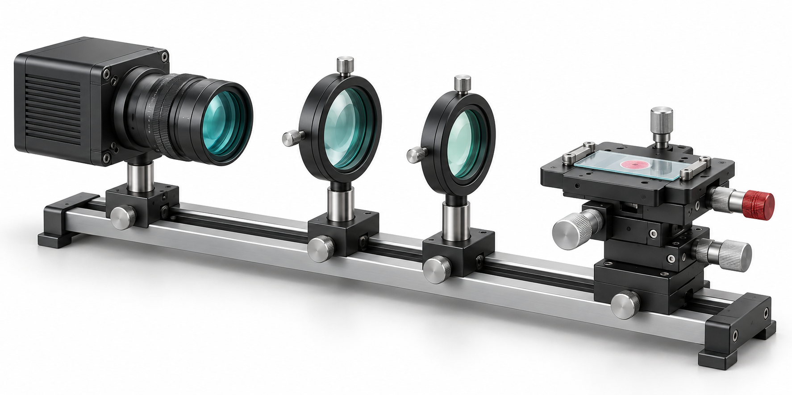

# Image2 / 按需生图

目标是补充**有解释作用的视觉素材**：具体器件/场景、概念性三维示意、抽象机制的直观比喻或没有现成图的背景。生成结果放在主图位置，再用原生文字和形状标注；不能把整页文字、公式、图表交给生图后当作可编辑 PPT。

## 工具选择

1. 有内置生图工具时，优先调用（例如 Codex 的 `image_gen`）。按当前工具 schema 传参；如已安装 `imagegen` skill，读取其入口并遵循生成/编辑流程。不要求用户提供 API key。
2. **“GPT Image 2 模型”与“内置生图入口”分开记录。** 内置工具若不暴露模型选择或返回模型名，只能写“内置生图”，不得声称已经验证底层为 GPT Image 2。
3. 用户要求可确认的 GPT Image 2，且当前工具提供模型参数时，使用 `gpt-image-2` 并记录返回的模型信息。若需要单独 API/CLI，先确认用户选择此路径；有已安装 `imagegen` 时使用其现有 CLI，而不是复制私有运行时路径或另造未验证客户端。密钥只放本机环境变量，不写入 PPT、日志或仓库。
4. 无可用工具时，保留精确提示词和待生成位置并说明未执行。不能用空白占位或框线图声称已生图，也不静默换模型。安装本 skill 不会自动提供模型账户、额度或网络服务。

当前已安装 imagegen 的 GPT Image 2 指南注明：显式 API 模型 ID 为 `gpt-image-2`；`quality` 可为 `low/medium/high/auto`；图像输入使用高保真，不再传 `input_fidelity`；该模型 CLI 不支持透明背景。执行前以环境中的当前文档和参数校验为准。需要透明背景时优先使用支持透明输出的内置工具；精确模型任务不能未经确认切换模型。

## 页面内决策

- 已有可靠科学图能说明问题：先使用、裁剪或重排。
- 需要精确拓扑、数据、结构维度、坐标和公式：使用原生形状、真实数据图表、MathType；生成图仅可作辅助。
- 缺少可用的器件/概念配图，且一张图能减少抽象叙述：直接生成，不逐图重复询问已授权的生图需求。
- 实验图、设备实拍、病理/显微图、重建结果、对比曲线和定量证据缺失：向用户索取或标注缺口；禁止生成后充当真实证据。

先完成一个样例并检查风格，再按必要性补图。没有固定每页一图的配额，也不为了丰富画面而添加与内容无关的物体。

## 提示词与记录

```text
用途：科研 PPT 的[机制/背景]配图，不是实验结果
主体：[具体对象及必要部件]
科学约束：[有来源的连接/结构；未知部分不臆造]
风格：与现有模板协调，清晰实体形态，适度立体感
构图：[将占据的区域与长宽比]，为原生标注留白
文字：图中不生成正文、公式、数据、坐标、品牌或机构标志
输出：[白底/工具支持时透明底]，独立图片
禁止：虚构结果、无依据的光路/接线、伪造真实设备身份
```

编辑已有图片前先看图，明确哪些部分能改。实验图默认不做生成式美化；不得改变可见证据。新生成图写入本次项目 `assets/generated/`，保留原图，并记录 `提示词 / 工具 / 实际可知模型 / 文件 / 对应页 / 概念用途 / 目视检查状态`。用“概念示意”区分生成内容与实验实拍，必要时在图注与备注写明。

## 随包样例



这个样例通过内置 `image_gen` 于 2026-10-26 生成；工具未返回可核实的模型 ID。它用于展示材质、体积感和留白，**不是已验证的光学设计、真实装置或实验照片**。画面无标签，使用时在 PPT 内补充原生说明。生成素材不宣称具有排他权或第三方权利保证，按生成服务的适用条款使用。

生成提示词：

> One clean scientific editorial illustration of a generic modular optical imaging experiment: a compact monochrome industrial camera with a blue-green glass front lens on the left, a metallic optical rail with two circular lenses in the middle, and a specimen slide on a three-axis translation stage on the right. Three-quarter isometric view, substantial filled forms and realistic materials, white background, gentle shadows, charcoal silver, muted teal glass and one small red accent. Wide composition and whitespace for PowerPoint captions. No rays, arrows, labels, letters, equations, charts, scale bars, people, brands or logos. An illustrative concept, not an experimental photograph.

本例提示词省略了工具调用中重复的排版约束，保留所有实质要求；没有参考输入图。其他任务不应因这个样例而默认使用光学题材。

生成后目视检查物体、结构、伪文字、边缘、背景和留白。复杂科学结构不可靠时使用简单实体配图，将准确关系交给原生箭头和文字。最终仍按 [制作流程](production.md) 检查整页。
