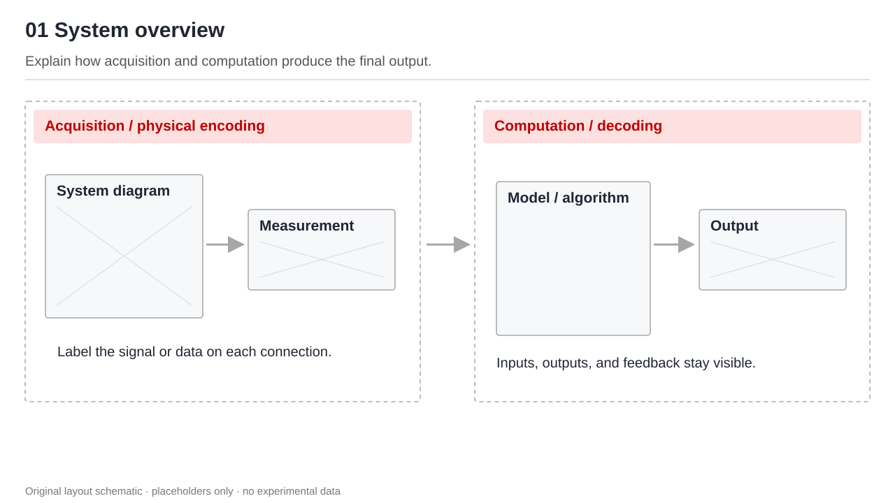
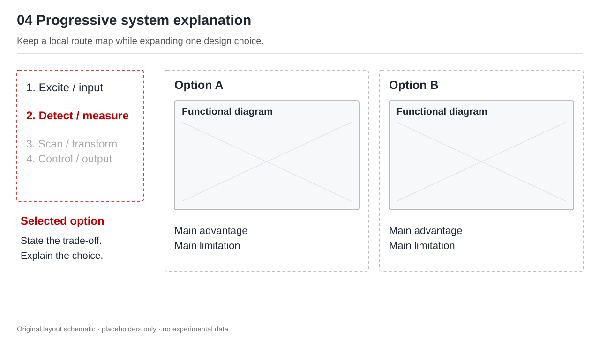
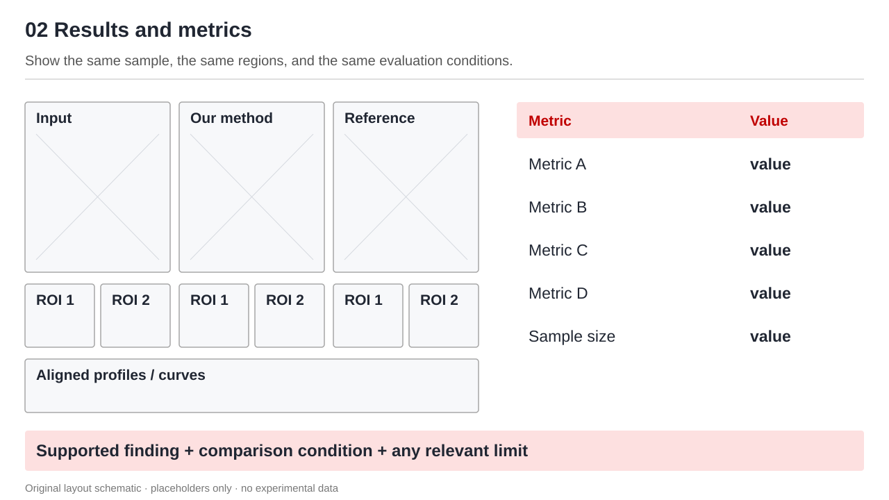
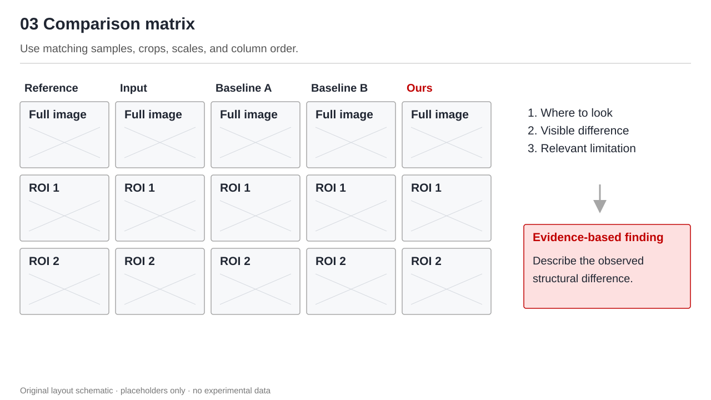
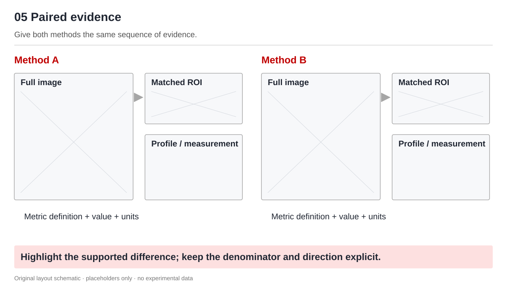
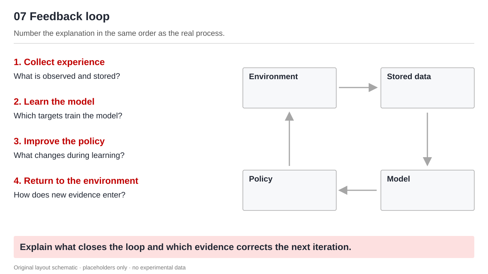
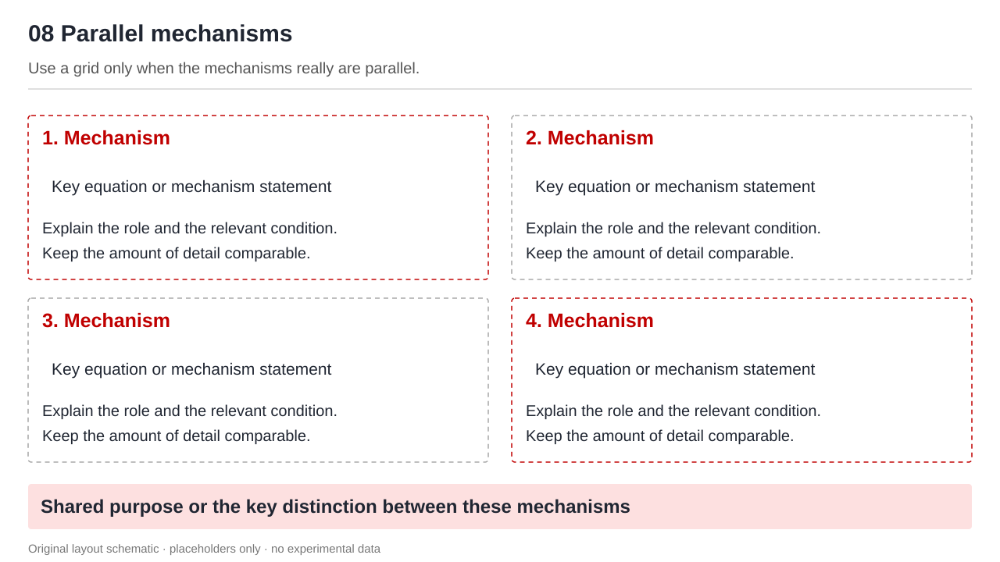
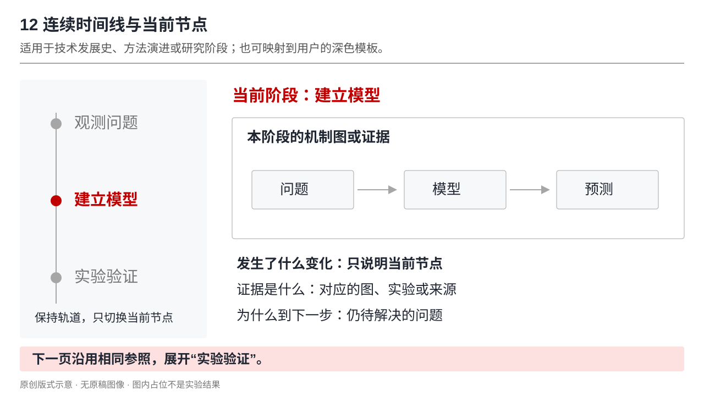
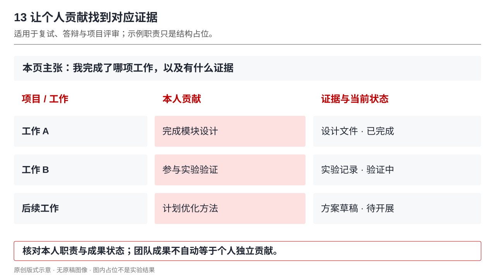
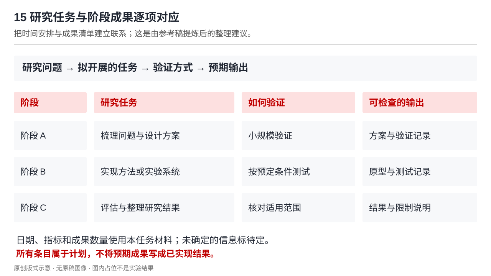

# 主体版式配方

以下比例均相对于当前模板允许的主体区，是建议起点。按内容选择配方，不能要求每份 PPT 包含所有配方。配图为本仓库原创的通用版式示意，只有占位标签，没有真实研究图像或数值。它们展示视觉关系，不是可直接使用的实验结果。

## 1. 系统 / 方法总览

**适合：** 先把物理采集和算法处理、输入和输出讲清楚。

主区横向布置 2–4 个阶段。两大子系统可各占约一半，使用轻标题带或虚线框分组，箭头越过组间空隙。子系统内部保留必要器件或计算模块；数据产物紧挨它产生的位置。可用真实输入和输出小图建立直观联系。

每组标题说功能，连接线说传递的量。不要用均匀的“步骤卡片”抹掉真实系统的分支和反馈。

## 2. 主图 + 解释 / 公式

**适合：** 机制、概念、模型结构，以及一张图配几个关键公式。

约 55% 宽度放结构图，约 42% 放解释，剩余作为栏间空隙。左右可交换。主图旁的小标题应与图中模块对应；每个解释块包含编号标题、必要公式、1–2 句作用或变量说明。图下可放符号表，底部可放一条局限或承接语。

公式是论证的一部分：交代符号指向、状态或信号怎样变化。不要用无关公式填空，也不要把公式压得比解释还难读。

## 3. 连续系统页中的逐步拆解

**适合：** 一个系统需要多页讲硬件选型、采集、扫描、控制。

左侧约 22%–26% 放简短步骤列表及本步结论，右侧放本步的示意、对比、实物或参数。当前步骤用强调色；已讲或未讲部分用黑色或浅灰区分。右侧两种技术的对比可用两个等宽细线分区，差异点就近着色。

该列表是页内阅读路标，内容需随系统调整。它与顶部模板章节导航不同，不应复制长汇报固定的四个步骤。

## 4. 图像结果 + 指标 + 一句结论

**适合：** 一种条件下展示方法是否有效。

左约 55% 放输入、方法结果、参考图及对应 ROI，右约 40% 放关键指标表，底部预留短结论。图像矩阵中的列对应方法、行对应整体或同一 ROI。指标数值保持一致精度、单位及均值 / 标准差口径。

结论点出本条件下支持的效果与限制。若只有定性图而没有量化数据，就解释可见现象；不补造指标，也不直接宣称速度、精度或临床效果得到证明。

## 5. 多方法比较矩阵

**适合：** 基线、多个方法及局部结构比较。

主区约 70%–78% 放多列图像矩阵，右侧放 2–3 条观察和一个短结论。所有方法使用同一对象、相同放大区域、同样的显示尺度及列顺序。量化表过密时另开相邻一页，沿用方法顺序和实验条件。

让“看哪里”的文字指向具体结构，例如连续性、边界、分叉或纹理。结论不能仅靠给自己的方法加红框。

## 6. 两方案对称证据链

**适合：** 两种重建、处理或系统方案的定量差异。

主体等分左右。两边都采用同一条链：整体图 → 同位置 ROI → 局部曲线或测量值 → 方法名。连接线颜色和方向一致。底部用一句话收束差异，可突出真实数值。

指标定义和比较方向必须明确。例如宽度减小百分比与其倒数指标提升百分比不能混用。借用排版时不继承其他研究的数值或有效率。

## 7. 闭环图 + 顺序讲解

**适合：** 训练闭环、控制闭环、数据迭代流程。

一侧约 40% 放编号讲解，另一侧约 55% 放大闭环图。每一条解释对应一个节点或一段箭头，并说清输入、执行动作和产出。可在讲解列下方用浅底短句指出循环的意义。

方向和阶段必须真实：采集、模型训练、策略学习和执行不能仅靠视觉箭头混在一起。流程没有闭环时不要套用环形构图。

## 8. 并列机制四分区

**适合：** 确有四个并列机制，各自信息量接近。

上方一句共同问题，下方 2×2 分区。每区放红色编号标题、一个核心表达式或机制句、简短解释。用细灰线或虚线划分，底部浅色条收束共同目的。重点区可用红细框，其他区保持弱边界。

只有两个或三个机制时改成双栏或三段；长推导或主要图示应获得更多空间，不强行塞入等面积网格。

## 9. 文献来源 + 系统 + 实验证据

**适合：** 在一页里回答一篇论文“做了什么、怎样做、凭什么成立”。

顶部用主体高度约 10%–15% 放简短来源与研究问题，完整书目信息放备注。下方约 60% 宽放系统或核心机制图，另一侧放结果图、关键条件及 1–2 句解读。引用放在对应图或页附近；综合多篇时逐图标注来源，不能用一条引用覆盖全页。

实验结论、论文作者的解释和自己的评述要分清。结果图需要足够空间读清坐标与图例；内容过多时拆为“机制”和“证据”两页，维持同一来源标识。

## 10. 具体算例 → 过程 → 公式

**适合：** 抽象距离、统计量、矩阵分解等需要先建立直觉的原理。

主体用不等宽分区：左上放输入或问题，右侧放操作和中间状态，左下放公式与代入步骤。用 1、2、3 编号规定顺序，底部收束定义或适用条件。算例规模应足够小，观众能逐项对应，而不是在一页展示完整计算任务。

图中的数量、公式下标和代入数值须一致；教学数字标明“示意”。对于矩阵式，可改为上方输入条件、中间带行列维度的大矩阵、下方求解与用途。

## 11. 方案 × 优势 / 代价矩阵

**适合：** 多条技术路线看起来都可行，需要解释为什么选择某一条。

左侧约 20% 列出方案；中间和右侧各约 38% 放优势与限制，其余留作间距。每行对应一个方案，行基线对齐。可按任务改为速度、精度、成本等同级比较维度。只强调与当前目标相关的单元格。

结尾给出“在某约束下倾向某方案”，同时保留代价与待测项。不把没有实测的数据写成高低排名；方案太多时先分组，再做详细矩阵。

## 12. 连续时间线 + 当前节点详解

**适合：** 技术发展史、方法演进、研究路线与阶段进展。

左侧约 25%–30% 保留短时间线或阶段线，当前节点以强调色标记；右侧展开该节点的“变化 / 代表机制或证据 / 带来的问题”。下一页沿用轨道与位置，只切换当前节点及证据。时间很长时仅保留相邻节点和当前阶段，不把所有年份压到一页。

节点可以是日期，也可以是“观测—建模—验证”；非时间关系不用年份伪装。深色背景仅在模板允许时采用，白底也能实现相同的信息结构。

## 13. 个人贡献 + 对应证据

**适合：** 复试、答辩或项目评审，需要回答“你负责了什么，完成到了哪一步”。

上方用一句话写本人的具体职责；下方用对齐的项目 / 工作、本人贡献、证据与状态三列，或左侧贡献说明、右侧对应实物和结果。少量关键职责可用强调色。论文、专利、软件或系统照片只放与本页贡献直接相关的部分。

把“独立完成、主研、参与”与来源记录核对；把“已完成、验证中、投稿中、计划”明确区分，项目级成果不能自动算作个人独立成果。证书或批文不是实验结果，研究图片也不能证明某人的署名或职责。个人信息页只在用户需要介绍经历时使用。

## 14. 研究版图 + 当前工作定位

**适合：** 一条研究主线有多个方向，需要说明本次工作处在哪一环、与后续方向如何连接。

中间横排 3–5 个有意义的环节，每列放短名称、功能图或关键对象、研究动作；当前工作单独加框或强调色。上下方用短注释解释关联方向。只有确实存在先后或数据传递关系时才连箭头；领域分类本身可以只是并列分区。

后续研究计划页沿用相同版图，标出“已有基础 / 本次工作 / 拟扩展方向”，避免每页重新定义词汇。不要把原参考的五个领域名称变成所有学科都必须使用的栏目。

## 15. 研究任务 + 阶段成果

**适合：** 博士研究计划、开题、项目推进或阶段安排。

先明确研究问题，再按阶段对齐“任务 / 如何验证 / 可检查的输出”。可用上方时间安排、下方预期成果，或简洁的阶段表。原参考采用时间列表与成果列表分区；下图把它们进一步对应，是面向新稿的整理建议。

日期、依赖和目标来自本任务材料。论文数量、专利数量、指标目标等只有用户明确给出时才采用，并标为目标；未知项标待定。计划页使用“拟开展、目标、预期”，不得写成已实现的结果。阶段多、说明长时拆页，优先保留验证方式。

## 不必另造复杂版式的情况

- 实物实现：一张占主区的大照片配少量引线标注，或全景与局部并排。把部件名放在部件附近，避免交叉引线。
- 定量汇总：表格或曲线本身成为主角。强调少量关键行列，保留单位、样本范围和必要不确定性。较多统计结果可以放在附录，主要结论仍需足够证据。
- 总结：问题 → 方法组成 → 得到的证据 → 仍需推进的方向。按纵向关系组织，不复制其他研究的结论数字。
