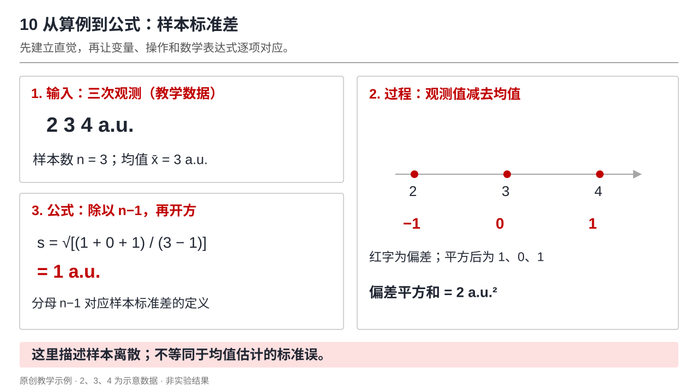
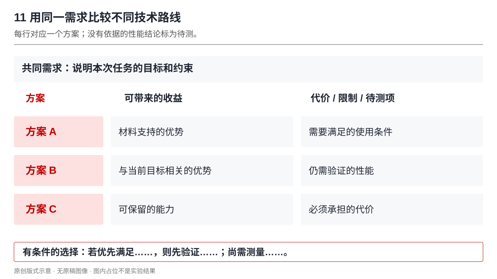

# 排版有什么用，以及怎样用

本 skill 适合已有论文、实验图、推导或草稿，需要让观众更快理解“问题—方法—证据”的场合。它把内容区的阅读顺序、图文对应和结论依据整理清楚；模板仍由你决定。

## 按你遇到的问题选版式

| 现状 / 想解决的问题 | 推荐版式 | 排版后的作用 |
|---|---|---|
| 系统图很复杂，观众分不清输入输出 | 1 系统总览；3 逐步拆解 | 先建立全貌，再沿同一顺序展开模块 |
| 公式很多，变量和物理含义脱节 | 2 主图与公式；10 具体算例 | 让符号对应图中的对象与实际操作 |
| 有结果图但观众不知道看哪里 | 4 结果与指标；5 比较矩阵；6 对称证据 | 对齐条件和 ROI，让观察与指标互相支持 |
| 训练、控制或更新过程容易混淆 | 7 闭环讲解 | 区分输入、执行、产出及反馈 |
| 确实有几个并列机制 | 8 并列机制 | 用相同层级解释各机制的职责 |
| 组会要讲几篇论文 | 9 文献与证据 | 逐篇连接来源、机制、结果和局限 |
| 多种技术路线都可行 | 11 取舍矩阵 | 明确比较维度，说明选择的前提 |
| 发展史或研究过程缺乏连贯性 | 12 连续时间线 | 固定参照，只改变当前节点 |
| 答辩中说不清自己负责什么 | 13 个人贡献与证据 | 将职责、证据和当前状态对应 |
| 听众不知道本次研究在全局中的位置 | 14 研究版图 | 标出当前工作和拟扩展方向 |
| 研究计划只有时间或成果数量 | 15 研究任务与阶段成果 | 关联任务、验证方式和输出 |

详细配方与 15 张示意见 [layouts.md](layouts.md)。编号只是检索入口，默认让 AI 根据材料选择，不必一次用齐。

## 例 1：把“公式堆叠”变成可以讲清的原理页

**输入：** 一页混放均值、标准差和标准误公式，没有变量解释。

**目标：** 本页只讲“样本标准差如何描述观测值的离散”；标准误另页解释，避免把样本离散与均值估计的不确定性混为一谈。



**排版：** ① 左上给出教学数据 2、3、4，单位统一为 a.u.；② 右侧以数轴显示均值 3 及偏差 −1、0、1；③ 左下代入样本标准差公式，得 s = 1 a.u.；底部写“描述样本离散，不等同于均值估计的标准误”。这些是教学数值，不是实验结果。

**制作：** 数据点、箭头、变量标签用可编辑形状；所有公式用 MathType，包括结果 `s=1\,\mathrm{a.u.}`，保留 LaTeX `s=\sqrt{\frac{\sum_{i=1}^{n}(x_i-\bar{x})^2}{n-1}}`。保存后逐个用 MathType 重新打开验证，见 [公式规则与例子](mathtype.md)。若另做标准误页，注明其所需的独立、同分布等假设，不无条件把 s/√n 当作所有测量的总不确定度。

**约 40 秒讲稿：** “先看左上三次观测。它们的均值为 3。右图把每次观测减去均值，得到 −1、0、1。将偏差平方相加，再除以 n−1 并开方，得到样本标准差 1。这里描述的是观测的离散程度。下一页再区分均值估计的不确定性。”

可直接使用：

```text
使用 $hjs_ppt，把这页统计原理改为“具体算例→过程→公式”。
保留蓝色模板。使用 2、3、4 作为明确标注的教学数据，讲样本标准差，
不要把它写成测量的总不确定度。所有公式必须使用 MathType 并可重新编辑，附逐页讲稿。
```

## 例 2：讲一篇论文时，让结论能找到证据

**输入：** 用户提供论文 PDF、图 2 系统图、图 4 的实验面板和测试条件。

**排版：** 顶部为核对后的短引用及问题；左约 60% 是图 2 的必要部分；右侧是图 4 中与当前结论直接相关的面板，附单位、样本条件和解释。没有量化数据时只描述可见差异。


**材料记录示例（结构示范，不是真实论文引用）：**

| 来源键 | 素材位置 | 可以支持 | 仍需确认 |
|---|---|---|---|
| S1 | 用户论文，图 2 | 系统组成与信号流向 | 缩写及器件功能 |
| S1 | 同文献，图 4 的选定面板 | 所报告条件下的结果比较 | 样本数、ROI 与显示范围 |

**讲稿骨架：** “这篇工作试图解决……；左图的……模块完成……；看右图的同一位置……；因此当前证据支持……；但还没有证明……。”省略号只能由实际材料填入。

```text
使用 $hjs_ppt，按“来源＋系统＋实验证据”讲这篇论文。
先整理来源页码、图号、数据及结论对应关系，再制作内容页。
不要编造缺失指标；在备注中保留完整引用，附可读的图例和局限。
```

## 例 3：方案总结不再只是“优点列表”

**输入：** 三个方案的说明，尚无可比实测数据。

**排版：** 行是方案 A/B/C，列为“可带来的收益”和“必须承担的代价”。根据同一任务需求填写；无依据的字段标“待测”。底部可写“若优先满足现有接口约束，则先验证方案 B；仍需测量延迟”。这是有条件的行动建议，不能写成“B 最优”。



```text
使用 $hjs_ppt，把这些方案整理成对齐的收益与限制矩阵。
我最在意兼容现有硬件和响应延迟。只使用已给出的事实，
没有测试结果的格子标为待测，最后给出有条件的选择和验证项。
```

## 例 4：复试汇报中的贡献与研究计划

**输入：** 用户自己的职责说明、系统示意、实物照片、验证记录和拟开展的研究任务。

先用研究版图标出当前工作；再用相邻两页展示系统原理与对应实物，模块名称保持一致；贡献页按“做了什么 / 对应证据 / 当前状态”组织。最后的研究计划只描述待开展任务，将各阶段的验证与输出对齐。原参考的个人成绩、论文状态、期刊指标、年份及成果数量不进入新稿。


```text
使用 $hjs_ppt，把这些材料整理为复试研究汇报。
先说明我的具体职责及可核对证据，再展示系统原理、实物和验证。
沿用同一研究版图解释后续任务。已完成、进行中和计划明确区分，
不要补造个人成果或承诺论文数量。保留我的模板，给出逐页讲稿。
```

## 从材料到成片的完整调用

```text
使用 $hjs_ppt 制作中文科研汇报，保留我提供的模板。
先整理材料和证据对应关系，再按每页问题选版式。
所有公式必须使用 MathType 并可重新编辑；数据图优先原生可编辑；逐页写讲稿并写入备注。
导出后渲染全部页面，检查遮挡、小字、图例、比较条件和模板保留区。
若当前环境已安装 PPT Master，可用它完成材料转换和原生导出；
主体排版以 hjs_ppt 为准。交付时列出实际验证和不可编辑对象。
```

制作流程见 [production.md](production.md)，后端接入与限制见 [ppt-master-integration.md](ppt-master-integration.md)。仅需要排版意见时，可以要求只交逐页方案，不必生成 PPTX、备注或完整材料清单。
